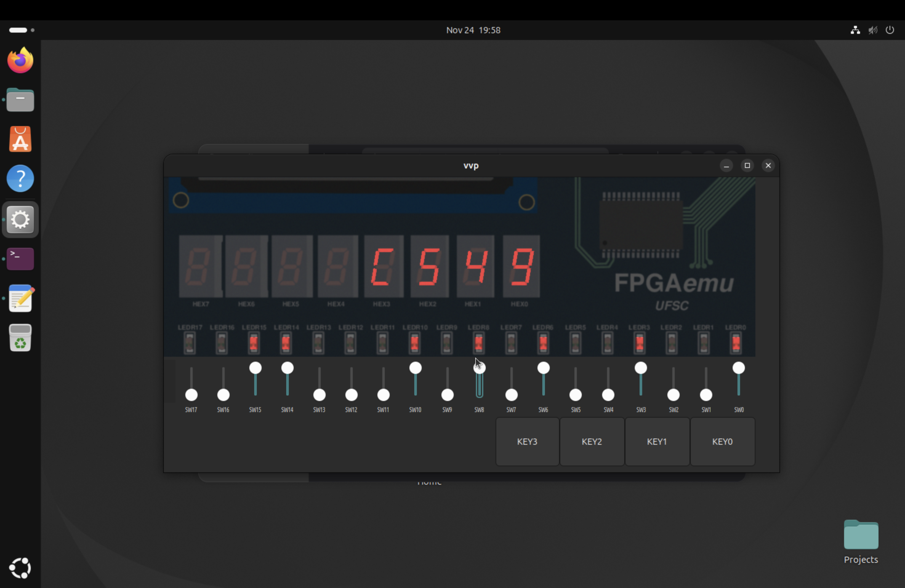

# FPGA Projects

## 4-Digit Hex Decoder

A seven-segment hex decoder written in Verilog and tested on the [FPGAemu](https://fabian.paginas.ufsc.br/en/tools/fpgaemu/) virtual DE2 board. Four groups of switches each select a hex digit (0–F), shown on displays HEX3–HEX0.



### How it works

I derived a logic equation for each of the seven segments (a–g) using K-maps ([K-maps.pdf](K-maps.pdf)), then wrote them as `assign` statements in a `hexdecoder` module. The top module, `usertop`, uses four copies of the decoder, one per display.

| Switches | Display |
|---|---|
| SW15–SW12 | HEX3 |
| SW11–SW8 | HEX2 |
| SW7–SW4 | HEX1 |
| SW3–SW0 | HEX0 |

### Running it

Requires FPGAemu and Icarus Verilog on Linux.

```bash
vfpgacompile hexdecoder.v
./vfpgatest
```

### What I learned

- Checking every K-map against the full 0–F truth table caught label errors in two of my equations.
- FPGAemu connects to all 15 ports of `usertop` by position, so every port must be declared, even unused ones.
- The displays are active-low, so each segment equation is inverted before driving the display.
